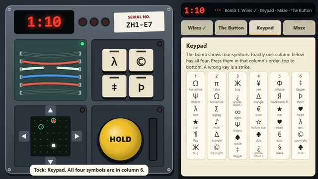

# Bomb Defuse

One sees the bomb. Everyone else has the manual. A multiplayer starter game from [Multiplayer Agent](https://multiplayeragent.com): 2D, co-op, 2–6 players, with a bot that reads you the manual when you play alone.

## How it plays

The defuser sees wires, a big button, a symbol keypad and a maze, but no rules. The others have the manual but can't see the bomb. Talk fast: every mistake is a strike and makes the clock run faster.

**Controls:** Click or tap wires, keys and the button (hold it when told); arrow keys, WASD or tap the grid for the maze; quick-chat buttons or type.

## Make it yours in the Game Builder

Open the [Game Builder](https://multiplayeragent.com), choose **Start from a starter game** and pick Bomb Defuse. It opens as version 1 in your studio, ready to play and publish. Then ask for changes, for example:

- Add a module with a dial you turn to the right number
- Make the defuser change every module instead of every bomb
- Set it in a spy lab with laser tripwires

## Run it yourself

1. Get a free publishable key (`pk_…`) at [multiplayeragent.com](https://multiplayeragent.com).
2. In `index.html`, put it in place of `pk_REPLACE_ME` in the `MP_CONNECT` block.
3. Open `index.html` in a browser. No build step and no server needed.

Without a key it still runs, offline, with the bot reading the manual.

## How it is built

- One `index.html`. The comment at the top of the script maps the code and explains the multiplayer.
- **Hidden info:** The bomb is sealed so only the defuser can see it (the host makes it, so it can too).
- **Host-run rules:** The host's browser runs the clock and checks every cut and press; if it leaves, the next player takes over.
- **Bots:** Alone, a bot named Tock reads you the manual, one rule at a time.
- **Leaderboard:** The most bombs your team defused in a row.
- The rules live in one data block (THE MANUAL): change a rule there and the manual pages, the checks and the bot all follow.
- `?attract` runs it offline with bots only. The preview video is recorded from it.

## License

MIT.
